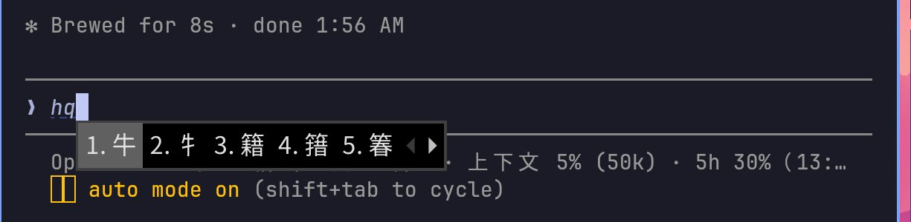

# omarchy-pad

把 Android 平板變成**鍵盤操作的 Linux 開發桌面**：Termux 原生 + Termux:X11 + i3，外觀與快捷鍵仿 [Omarchy](https://omarchy.org)（Tokyo Night、平鋪視窗、Super 鍵操作）。
不用 root、不用 proot，直接在平板上跑 kitty、Neovim、lazygit 和 **Claude Code**，也能一鍵 mosh 回 Mac。

> **這是一份個人設定，不是固定的產品。** 快捷鍵、配色、狀態列、工具、連線對象……每一樣都可以照你的習慣改掉、拿掉或加上新的。
> 建議先 fork 成你自己的 repo 再改；最省事的方式是交給 AI agent（見[交給 AI agent](#交給-ai-agent)）。

> *English: a keyboard-driven i3 desktop for Android tablets on native Termux + Termux:X11 (no root, no proot), styled after Omarchy. Runs Claude Code natively, GPU-accelerated kitty, Chinese input via fcitx5. Built and tested on an OPPO Pad 4 Pro (ColorOS 16 / Android 16); docs are in Traditional Chinese.*


## 特色

| | |
|---|---|
| **Omarchy 風格 i3** | 每個桌面預設是分頁（每個視窗全螢幕）；按 Super+S 改成並排，自動排版：2 個左右、3 個左一右二、4 個田字 |
| **GPU 加速終端機** | kitty 經 zink（Adreno 的 Vulkan 驅動 Turnip）用 GPU 繪製，CPU 用量約為軟體繪圖的 1/9；可調解析度比例換取更低延遲 |
| **Claude Code 原生執行** | Android 沒有官方版本；這裡讓 linux-arm64 glibc 版直接在 Termux 跑。Claude 要你回應或做完長工作時用語音提醒，底部狀態列顯示模型、上下文用量、5 小時／7 天額度與花費 |
| **快捷鍵表 + 啟動器** | Super+Space 第一項是快捷鍵表和系統資訊，可搜尋、Enter 直接執行；內容從 i3 設定檔的註解自動產生，改快捷鍵不用另外維護文件 |
| **中文輸入** | fcitx5 + 自由大新倉頡，Ctrl+Space 切換；另支援 Speak Only 語音輸入 |
| **月曆** | 台灣國定假日、補班，加上美股休市與提早收盤 |
| **狀態列** | 電池（低於 25% 紅、25–40% 橘、40% 以上綠）、中／英、Mac 連線狀態、記憶體、溫度 |
| **連回 Mac** | Super+M：mosh 到 Mac 開 herdr（終端機多工），斷線自動重連 |
| **一鍵啟動** | Termux:Widget 捷徑啟動／關閉整個桌面；同時開 sshd，可從電腦 ssh 進平板 |
| **ColorOS 修正** | `android-setup.sh` 從電腦用 adb 修好會讓桌面失效的系統設定（見下方） |

<table>
<tr>
<td width="50%"><br>Super+Space → Key Cheat Sheet：系統資訊與快捷鍵（右上是 Claude 等待輸入的通知）</td>
<td width="50%"><br>Calendar：台灣假日、補班、美股休市</td>
</tr>
</table>


<sub>自由大新倉頡：輸入 hq 出現候選字；下方是 Claude Code 狀態列（輪數、上下文用量、5 小時額度）</sub>

## 需求

- **Android 平板**，arm64，Android 12 以上。只在 OPPO Pad 4 Pro（ColorOS 16 / Android 16、Snapdragon 8 Elite）實測過；
  其他 Adreno GPU 的平板應該可以，其他廠牌的系統限制可能不同。GPU 加速需要 Adreno（Turnip 驅動），否則改用軟體繪圖（見「調整」）。
- **實體鍵盤**，有 Super（Windows／⌘）鍵最好；被系統吃掉的話可以改用 Alt。
- **四個 App，都從 GitHub 或 F-Droid 安裝**（不要用 Play 商店版：簽章不同，彼此無法互通）：
  [Termux](https://github.com/termux/termux-app/releases)、
  [Termux:X11](https://github.com/termux/termux-x11/releases)（nightly）、
  [Termux:API](https://github.com/termux/termux-api/releases)、
  [Termux:Widget](https://github.com/termux/termux-widget/releases)
- **一台有 adb 的電腦**（Mac 或 Linux），執行一次 `android-setup.sh`。
- 選用：一台 Mac（Super+M 連回去用；Tailscale 讓平板在外面也連得到）。

## 交給 AI agent

整個 repo 都是純文字設定和小腳本，[`CLAUDE.md`](CLAUDE.md) 記錄了每個檔案套用到哪裡、怎麼生效、以及已經踩過的坑，
所以很適合讓 Claude Code 之類的 agent 幫你安裝、適配你的平板，或照你的喜好改。

- **在平板上**：裝好之後直接在桌面的終端機執行 `claude`，在 repo 資料夾裡下指令。
- **在電腦上**（平板插 USB）：agent 可以用 adb 設定 Android，裝好之後再用 `adb forward tcp:8022 tcp:8022` 加 `ssh -p 8022 localhost` 進平板執行指令、截圖確認畫面。

把下面這段貼給 agent，`< >` 的部分換成你的情況：

```text
我要在 Android 平板上使用 omarchy-pad（https://github.com/ian902792/omarchy-pad），
並照我的需求客製化。repo 在 <平板：~/GitHub/omarchy-pad／電腦：路徑>。

先讀 README.md 和 CLAUDE.md：CLAUDE.md 有每個檔案的套用方式和已驗證的限制，不要重新踩一次。
我的環境：
- 平板：<廠牌型號、Android／系統版本、GPU>
- 鍵盤：<有沒有 Super 鍵、語言配置>
- 會不會用到 Mac 連線（Super+M / herdr）：<會／不會>
- 中文輸入：<自由大新／其他輸入法／不需要>
我想改的：
- <例：快捷鍵改成…、配色換成 Catppuccin、狀態列加…、拿掉月曆和語音提醒>

做法：
1. 先列出你打算改哪些檔案、為什麼，等我確認再動手。
2. 改 repo 裡的檔案（~/.config 裡的設定都是指向 repo 的連結），照 CLAUDE.md 的表格套用。
3. 套用後在畫面上確認（DISPLAY=:0；可以截圖），有問題先回報，不要一路猜下去。
4. 如果我的平板跟 CLAUDE.md 寫的不同（型號、路徑、限制），順便更新 CLAUDE.md 和 README。
5. 完成後用 git commit，訊息寫清楚改了什麼。
```

## 安裝

**1. 在 Termux 裡**（保持 Termux 在前景：ColorOS 會擋背景網路）

```sh
pkg install -y git
git clone https://github.com/ian902792/omarchy-pad ~/GitHub/omarchy-pad   # 或你 fork 的網址
bash ~/GitHub/omarchy-pad/install.sh    # 可重複執行，也用來更新
termux-setup-storage                    # 允許存取「下載」「圖片」（截圖、檔案管理器用）
```

install.sh 會：裝套件 → 字型 → 把 `config/*` symlink 到 `~/.config/`（原有的改名為 `*.bak.<時間>`）→ `bin/*` 連到 `~/.local/bin` →
建立 Termux:Widget 捷徑 → 建自由大新輸入法 → 下載 Claude Code → 產生 `~/.ssh/id_ed25519`。

**2. 在電腦上**：平板開啟 USB 偵錯、插上 USB，然後

```sh
git clone https://github.com/ian902792/omarchy-pad && cd omarchy-pad
./android-setup.sh          # 逐項檢查並修正；--check 只檢查不修改
```

**3. 在平板設定裡手動改**（adb 改不了）

- 電池 → Termux、Termux:X11（有用的話加 Tailscale）設為「不限制」
- 設定 → 應用程式 → Termux → **預設開啟** 改成「**在瀏覽器中開啟**」，否則點網址沒反應
- 允許 Termux:API 發通知（Claude Code 提醒用；語音提醒不需要）

**4. 第一次啟動**：打開 Termux:Widget App 按一次 **CREATE SHORTCUTS**，接著見下一節。

**5. 選用：連回 Mac**。Mac 開「遠端登入」、`brew install mosh`，裝好 herdr（`bin/omp-mac` 預設 Homebrew 路徑 `/opt/homebrew/bin`），把 install.sh 最後印出的公鑰加到 Mac 的 `~/.ssh/authorized_keys`，
再編輯平板上的 `~/.config/omarchy-pad/env`，把 `MAC=` 改成你的帳號和 Tailscale IP（Termux 解析不到 MagicDNS 名稱）。

## 啟動 / 停止

- **長按 Termux:Widget 的 App 圖示** → **Desktop Start**，約 3 秒後**點 Termux:X11 圖示**進入桌面（ColorOS 不准 Widget 自動把它叫到前景）；**Desktop Stop** 關閉
- 或放在主畫面的 Termux:Widget 小工具（`~/.shortcuts/tasks/`，背景執行）
- 或在 Termux 裡 `bash ~/GitHub/omarchy-pad/start.sh`（會先停掉舊的桌面）／`stop.sh`
- 桌面已經在跑、只是切到別的 App：直接點 **Termux:X11**（或從多工畫面切回去），不用重新 Start
- Start 也會啟動 sshd（port 8022，只收金鑰）並取得 wake lock，所以桌面開著時可以從電腦 `ssh -p 8022 <平板 IP>` 連進來；Stop 會放開 wake lock

## 快捷鍵（Super）

每個桌面預設是**分頁**：每個視窗一個分頁、各自全螢幕，上方是分頁列，Super+←／→ 切換。
要並排就在該桌面按 Super+S（再按一次回到分頁）。並排時自動排版（`bin/omp-tile`）：2 個左右、3 個左一右二、4 個田字、5 個以上等寬直欄。
忘記快捷鍵就按 Super+Space 看第一項 Key Cheat Sheet。

| 鍵 | 動作 |
|---|---|
| Super+T | 新終端機分頁（Super+Return 會被 ColorOS 攔走） |
| Super+Space | 啟動器（Key Cheat Sheet、Calendar、Shut Down Desktop、各 App） |
| Super+Tab | 切換視窗 |
| **Super+M** | 切到 Mac 的 herdr 分頁；還沒開就 mosh 過去開一個（只會有一條連線） |
| Super+E | 檔案管理器 Thunar（側邊欄有 下載／圖片／截圖／相機） |
| Super+Shift+S | 截圖，存到 Android 的 圖片/Screenshots |
| Super+W | 關閉視窗 |
| Super+C / Super+V | 終端機裡複製／貼上（與 Android 剪貼簿同步） |
| Ctrl+Space / Super+I | 中／英切換（自由大新）；Space 或 1…0 選字，- = 翻頁 |
| `\`（Ctrl+`\`） | Speak Only 語音輸入（翻譯）；沒裝 Speak Only 時照常打 `\` |
| Super+F / Shift+V / J / S | 全螢幕／浮動／切換分割方向／分頁與並排 |
| Super+方向鍵（+Shift） | 移動焦點（移動視窗） |
| Super+-/=（+Shift） | 調整寬度（高度） |
| Super+1…6（+Shift） | 切換桌面（把視窗移過去） |
| Super+Shift+R / Super+Escape | 重新載入 i3／關閉桌面（會先確認） |

## 終端機工具

install.sh 會裝好並設定（設定在 `config/bashrc`、`config/gitconfig`、`config/lazygit/config.yml`）：

| 指令 | 用途 | 常用 |
|---|---|---|
| `lg`（lazygit） | 選單式 git：看改動、分段 commit、切 branch、push | 空白鍵 stage、`c` commit、`P` push、`?` 說明、`q` 離開 |
| `ls` / `ll` / `tree`（eza） | 有顏色和圖示的 ls；`ll` 會顯示 git 狀態 | `ll`、`tree -L 2` |
| `cat`（bat） | 有語法高亮的 cat；要行號和捲動用 `bat 檔名` | `bat install.sh` |
| `z`（zoxide） | 打資料夾名稱的一部分就跳過去（只記得 cd 進去過的） | `z omarchy`、`zi`（用選單挑） |
| `fd` | 找檔案，比 find 快、語法簡單 | `fd watermark`、`fd -e sh` |
| `git diff`（delta） | diff 有語法高亮和行號；`n`／`N` 跳下一個／上一個檔案 | `git diff`、`git show` |
| `uv` | Python 版本、套件、虛擬環境 | `uv venv`、`uv run script.py` |

原本的指令都還在：`command ls`、`command cat`、`\cat`。

## Claude Code

直接在平板上執行 `claude`，第一次會要你登入。

- **怎麼跑起來的**：`bin/claude` 用 glibc-runner 的 loader（`$PREFIX/glibc/lib/ld-linux-aarch64.so.1`）啟動 linux-arm64 glibc 版。
  Termux 的 `LD_PRELOAD`（bionic 函式庫）無法載入 glibc 程序，所以只對 claude 本身拿掉；Claude 的 Bash 工具改用
  `CLAUDE_CODE_SHELL` 指向的小包裝，啟動 bash 前補回（`#!/usr/bin/env` 腳本才跑得動）。
- **提醒**（`bin/omp-claude-notify`，install.sh 寫進 `~/.claude/settings.json` 的 hooks）：Claude 要權限、問問題、或做完超過 20 秒的工作時，
  用英文語音念「Claude is done／Claude needs you」（媒體音量；`OMP_NOTIFY_VOICE=0` 關閉），並跳出桌面通知。
- **狀態列**（`config/claude/statusline.py`）：模型 · 第幾輪 · 上下文用量 · 5 小時／7 天額度與重置時間 · 花費。
- **更新**：自動更新已關閉（會覆蓋包裝）；重跑 `install.sh` 即可，或 `CLAUDE_VER=2.x.y bash install.sh` 指定版本。

## `android-setup.sh`：修正 Android 系統設定

這些設定在 Termux 之外，install.sh 碰不到。插 USB 在電腦上執行，逐項檢查並修正：

- **無障礙服務** `com.termux.x11/.utils.KeyInterceptor`：沒有它 Super 鍵失效，而且 Android 輸入法會先吃掉按鍵、游標亂跳
- **子程序限制**（Android 12+ 所有 App 合計 32 個，超過就把整個桌面連 sshd 一起殺掉）：關閉
- **Doze 省電豁免**：Termux、Termux:X11、Tailscale
- **Termux:X11 偏好**：全螢幕、隱藏瀏海、攔截 Meta 鍵、剪貼簿同步、縮放模式

**什麼時候要重跑**：系統更新後、重裝 App 後、Super 鍵又失效、或桌面莫名被關掉時。

## 客製化

所有東西都在 `config/` 和 `bin/` 裡，改完照 [`CLAUDE.md`](CLAUDE.md) 的表格套用即可（多半是 `i3-msg reload` 或開新視窗）。
下面只是常見的例子；用不到的功能直接刪掉也沒關係，不喜歡的就換掉。

| 想改 | 怎麼做 |
|---|---|
| 解析度／延遲 | `~/.config/omarchy-pad/env` 的 `OMP_SCALE`（原生解析度的 %，預設 75）：100 最清晰、50 最快，改完重開桌面。每一幀都要經過 X server，像素越少打字延遲越低 |
| 桌布 | 覆蓋 `~/.local/share/omarchy-pad/wallpaper.jpg`（預設是 Omarchy Tokyo Night 的 sunset-lake），按 Super+Shift+R |
| Super 鍵被系統吃掉 | `config/i3/config` 的 `set $mod Mod4` 改成 `Mod1`（Alt），執行 `i3-msg restart` |
| 快捷鍵 | 改 `config/i3/config`；在 `bindsym` 上一行寫 `#: 說明`，就會出現在 Key Cheat Sheet |
| 配色／主題 | 預設 Tokyo Night：視窗與狀態列在 `config/i3/config`、`config/i3status/config`，終端機 `config/kitty/kitty.conf`，啟動器 `config/rofi/config.rasi`，通知 `config/dunst/dunstrc`，提示字元 `config/starship.toml` |
| 狀態列 | `bin/omp-status`（電池、中／英、Mac 連線）和 `config/i3status/config`（記憶體、溫度、時間），加減區塊或改顏色 |
| 拿掉不用的功能 | 刪掉 `config/i3/config` 裡對應的 `bindsym`／`exec` 行（例如 Super+M、語音輸入），或 `install.sh` 裡對應的步驟（例如 Claude Code 提醒 hooks） |
| 終端機工具、別名 | `config/bashrc`、`install.sh` 的套件清單 |
| 不是 Adreno GPU／kitty 畫面錯亂 | `start.sh` 裡 zink 那行換成 `export LIBGL_ALWAYS_SOFTWARE=1`（軟體繪圖，較耗 CPU） |

## 已知限制

- Hyprland／Wayland 跑不了（Termux:X11 是 X server），所以用 i3。
- 狀態列只有記憶體、SoC 溫度、電池：Android 不讓 Termux 讀網路和 CPU 使用率。電池要裝 Termux:API。
- Super+Return 被 ColorOS 攔走，所以開終端機是 Super+T。
- 子程序限制、無障礙服務等系統設定在 ColorOS 更新後可能被改回去，重跑 `android-setup.sh`。
- Termux 解析不到 Tailscale 的 MagicDNS 名稱，連線用 IP。
- 更多已驗證的坑（含原因與解法）寫在 [`CLAUDE.md`](CLAUDE.md) 的 Constraints 一節。

## 檔案結構

```
install.sh          安裝／更新（可重複執行）
start.sh, stop.sh   啟動／關閉桌面
android-setup.sh    在電腦上用 adb 修正 Android 設定
config/             各程式設定，symlink 到 ~/.config
bin/                omp-* 小工具（狀態列、排版、月曆、快捷鍵表、提醒…），連到 ~/.local/bin
ime/newcj.cin       自由大新倉頡字表（Public Domain）
lib/omp-notag.c     關閉 Android 的指標標記，讓 i3 狀態列點擊正常
CLAUDE.md           給 Claude Code 的維護筆記：檔案對照、套用方式、已驗證的限制
```

改設定的流程：改 repo 裡的檔案 → 依 `CLAUDE.md` 的表格套用 → `git commit`。在平板和電腦各 clone 一份，用 git 同步。
`CLAUDE.md` 是寫給 agent 的地圖；fork 之後把裡面的路徑、裝置和限制改成你自己的，agent 就能照著維護。

## 授權

[MIT](LICENSE)。`ime/newcj.cin`（自由大新倉頡）為 Public Domain；桌布由 install.sh 從 Omarchy 下載，不包含在 repo 中。
