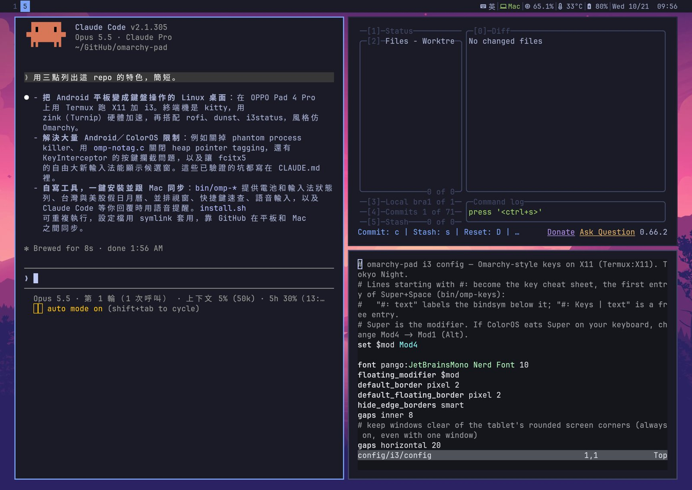
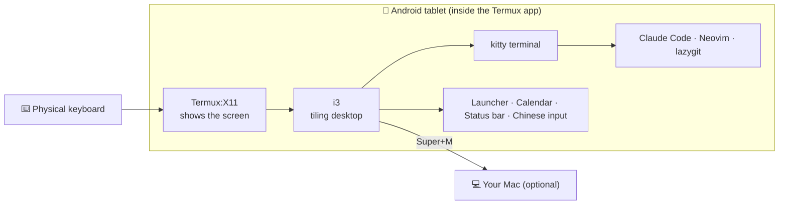
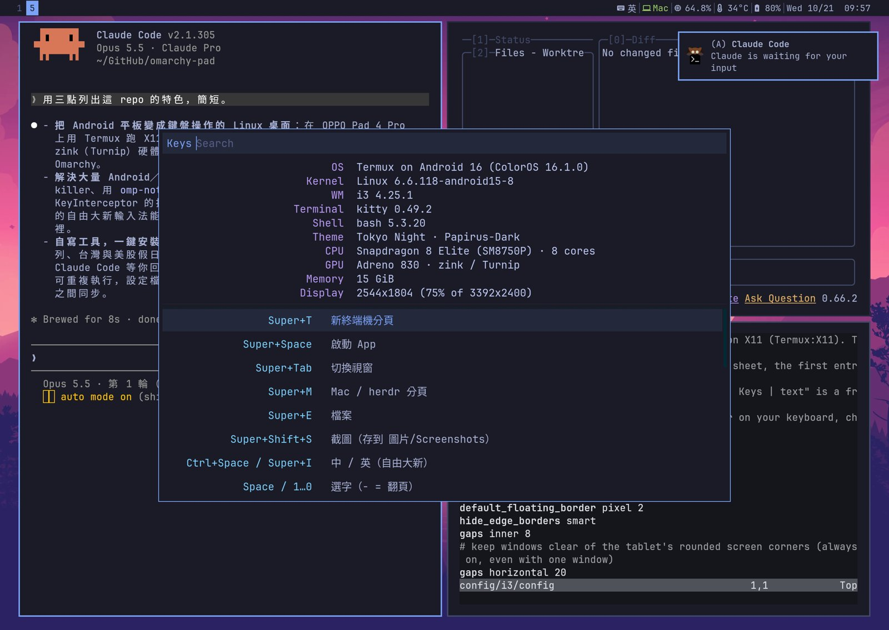
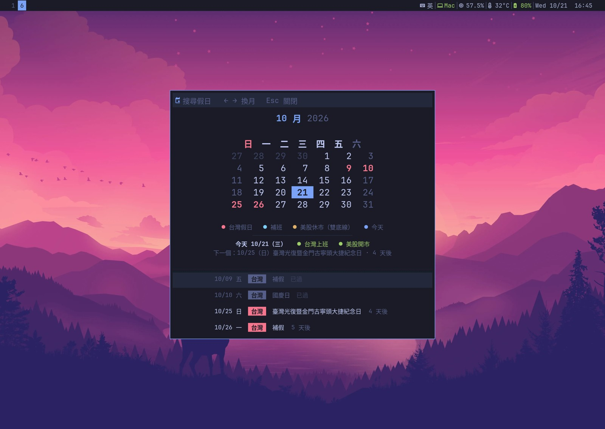
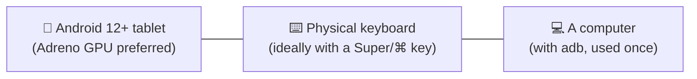
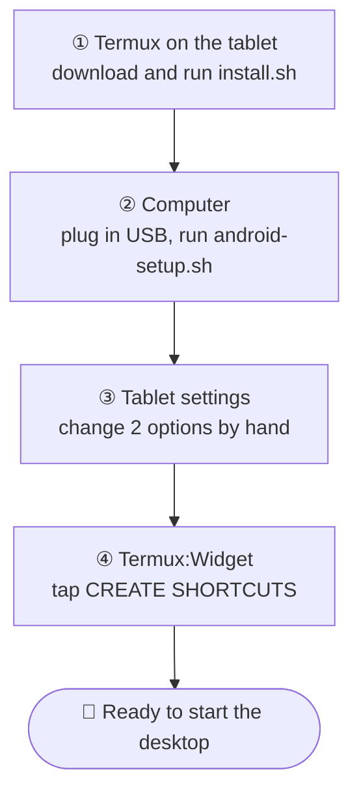
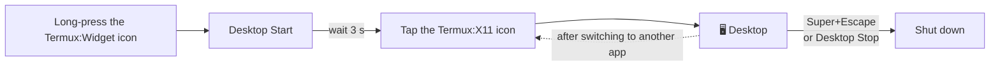
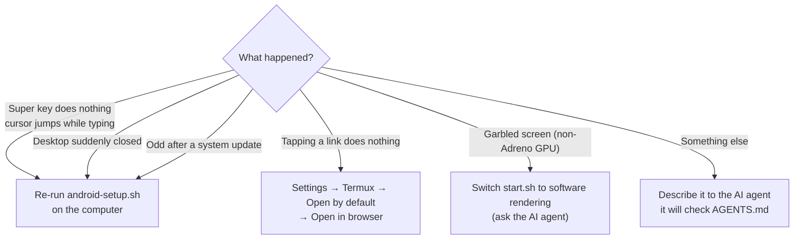
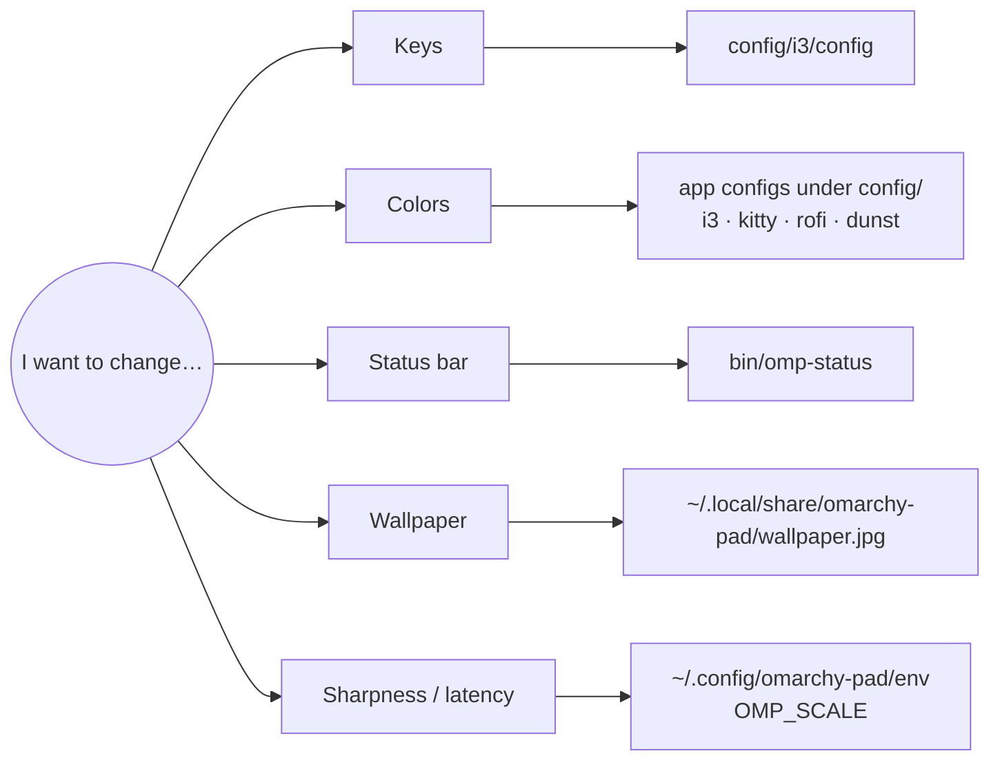
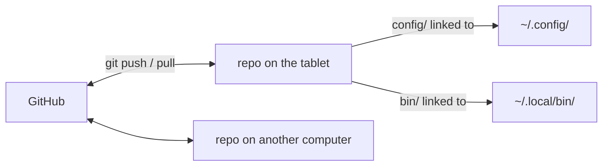

# omarchy-pad

Turn an Android tablet into a **keyboard-driven Linux desktop**, styled after [Omarchy](https://omarchy.org) (Tokyo Night colors, tiling windows).
No root needed: run **Claude Code**, Neovim and lazygit right on the tablet, and connect back to your Mac with one key.

**English** · [繁體中文](README.zh-TW.md)



## How it fits together



## Features

| | |
|---|---|
| 🪟 **Tiling windows** | Every window full screen by default; Super+S arranges them side by side |
| 🤖 **Claude Code** | Runs natively on the tablet and speaks up when it needs you |
| 🔎 **Key cheat sheet** | Forgot a key? Super+Space: searchable, Enter runs it |
| 🀄 **Chinese input** | 自由大新 Cangjie, Ctrl+Space to switch |
| 📅 **Calendar** | Taiwan holidays and make-up workdays, US market closures |
| 🔋 **Status bar** | Battery, input language, Mac connection, memory, temperature |
| ⚡ **GPU accelerated** | The terminal draws on the GPU: smooth and light on battery |

<table>
<tr>
<td width="50%"><br>Super+Space → key cheat sheet and system info</td>
<td width="50%"><br>Calendar: Taiwan holidays, make-up workdays, US market closures</td>
</tr>
</table>

## What you need



Then download four apps from GitHub (**not the Play Store versions**: they can't talk to each other):
[Termux](https://github.com/termux/termux-app/releases) ·
[Termux:X11](https://github.com/termux/termux-x11/releases) ·
[Termux:API](https://github.com/termux/termux-api/releases) ·
[Termux:Widget](https://github.com/termux/termux-widget/releases)

> Only tested on an OPPO Pad 4 Pro. Most other tablets should work; if yours differs, an AI agent is the quickest way to adapt it.

## The easy way: let an AI agent do it

This repo is all plain-text config. [`AGENTS.md`](AGENTS.md) records what every file does and the pitfalls already hit, so an agent like Claude Code can take you from install to customization.
Paste this into it and fill in the `< >` parts:

```text
Help me install and customize https://github.com/ian902792/omarchy-pad on my Android tablet.
Read README.md and AGENTS.md first, and tell me what you plan to change before you do it.
My tablet: <model>
I want to: <e.g. switch colors to Catppuccin, remove the calendar, no Mac connection>
```

## Install it yourself: 4 steps



**① In Termux** (keep Termux in the foreground while it installs)

```sh
pkg install -y git
git clone https://github.com/ian902792/omarchy-pad ~/GitHub/omarchy-pad
bash ~/GitHub/omarchy-pad/install.sh
termux-setup-storage
```

**② On your computer** (turn on "USB debugging" on the tablet and plug it in)

```sh
git clone https://github.com/ian902792/omarchy-pad && cd omarchy-pad
./android-setup.sh
```

**③ In the tablet's settings**
- Battery → set Termux and Termux:X11 to "**Unrestricted**"
- Apps → Termux → Open by default → "**Open in browser**"

**④ Open the Termux:Widget app** and tap **CREATE SHORTCUTS** once.

> Want Super+M to connect to your Mac? Ask the AI agent to set it up, or see `env.example`.

## Daily use



## Keys

Super is the Windows/⌘ key. **Can't remember? Press Super+Space**: the first entry is the full list.

| Key | Action |
|---|---|
| Super+T | New terminal |
| Super+Space | Launcher (cheat sheet, calendar, apps) |
| Super+W | Close window |
| Super+S | Toggle "full-screen tabs" and "side by side" |
| Super+←/→ | Switch window |
| Super+1…6 | Switch workspace |
| Super+E | File manager |
| Super+Shift+S | Screenshot |
| Super+C/V | Copy/paste |
| Ctrl+Space | Switch Chinese/English |
| Super+M | Connect to Mac |

Side by side arranges itself:

```text
 2 windows     3 windows     4 windows
┌────┬────┐  ┌────┬────┐  ┌────┬────┐
│    │    │  │    │    │  │    │    │
│    │    │  │    ├────┤  ├────┼────┤
│    │    │  │    │    │  │    │    │
└────┴────┘  └────┴────┘  └────┴────┘
```

Ready in the terminal: `claude`, `lg` (lazygit), `nvim`, `z` (jump to folders), `fd` (find files).

## When something goes wrong



## Make it your own

**Fork** it into your own repo first. Everything can be changed, swapped or removed:



Don't want to hunt for files? Just tell the AI agent "change ___ to ___".

<details>
<summary>How the repo relates to the tablet's settings (advanced)</summary>



Editing a file in the repo edits the tablet's settings. How each file takes effect is in the table in [`AGENTS.md`](AGENTS.md).

</details>

## License

[MIT](LICENSE). `ime/newcj.cin` (自由大新 Cangjie) is Public Domain; the wallpaper is downloaded from Omarchy by install.sh and not included in the repo.
