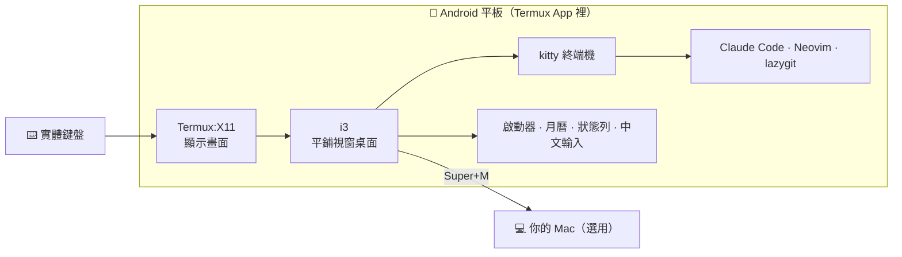
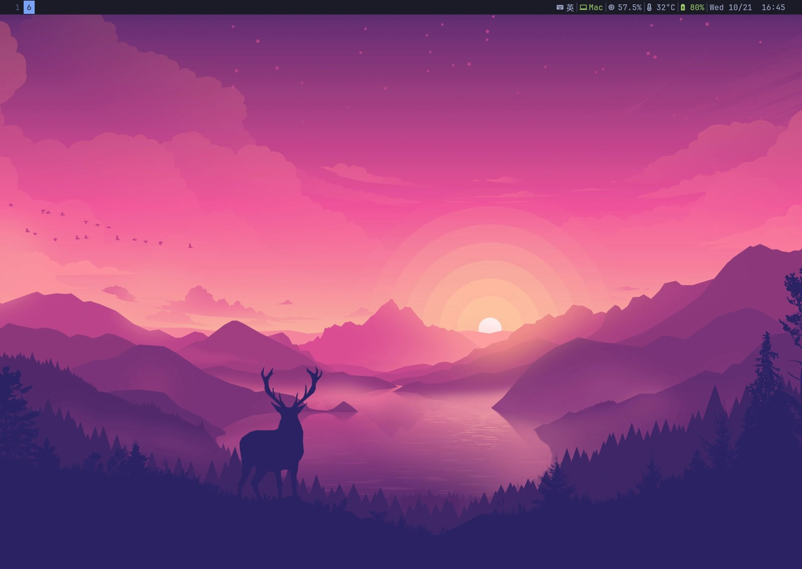
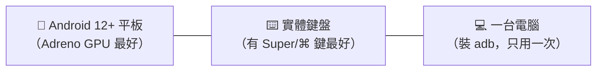
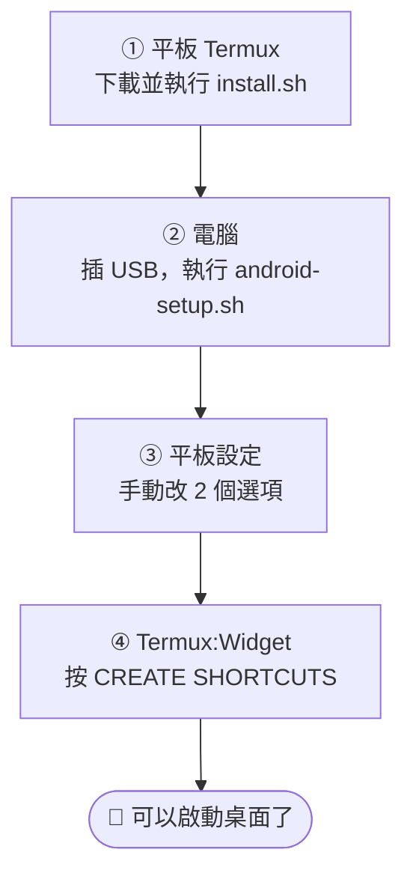
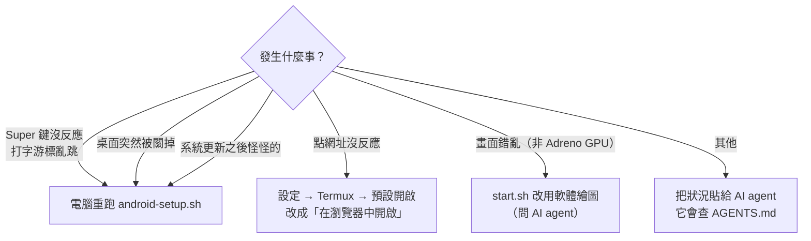
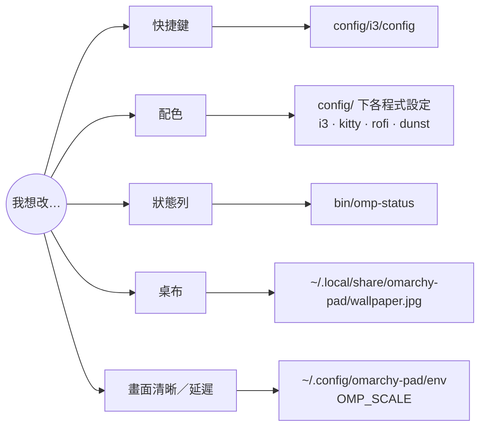
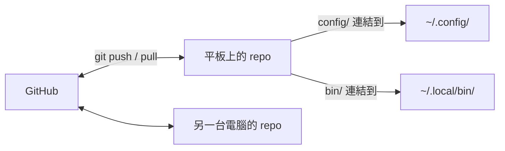

# omarchy-pad

把 Android 平板變成**用鍵盤操作的 Linux 桌面**，外觀仿 [Omarchy](https://omarchy.org)（Tokyo Night 配色、平鋪視窗）。
不用 root，平板上直接跑 **Claude Code**、Neovim、lazygit，也能一鍵連回 Mac。

[English](README.md) · **繁體中文**


## 它是怎麼組成的



## 特色

| | |
|---|---|
| 🪟 **平鋪視窗** | 預設每個視窗全螢幕；按 Super+S 自動並排 |
| 🤖 **Claude Code** | 在平板上原生執行；等你回應時會用語音提醒 |
| 🔎 **快捷鍵表** | 忘了就按 Super+Space，可搜尋、按 Enter 直接執行 |
| 🀄 **中文輸入** | 自由大新倉頡，Ctrl+Space 切換 |
| 📅 **月曆** | 台灣假日、補班、美股休市 |
| 🔋 **狀態列** | 電池、中／英、Mac 連線、記憶體、溫度 |
| ⚡ **GPU 加速** | 終端機用 GPU 繪製，省電又順 |

<table>
<tr>
<td width="50%"><br>Super+Space → 快捷鍵表與系統資訊</td>
<td width="50%"><br>月曆：台灣假日、補班、美股休市</td>
</tr>
</table>


<sub>新桌面：只有桌布和狀態列（桌面編號、中／英、Mac、記憶體、溫度、電池、時間）</sub>

## 需要準備



再到 GitHub 下載四個 App（**不要用 Play 商店版**，彼此會連不起來）：
[Termux](https://github.com/termux/termux-app/releases) ·
[Termux:X11](https://github.com/termux/termux-x11/releases) ·
[Termux:API](https://github.com/termux/termux-api/releases) ·
[Termux:Widget](https://github.com/termux/termux-widget/releases)

> 只在 OPPO Pad 4 Pro 實測過。其他平板大多能用，遇到不同的地方交給 AI agent 調整最快。

## 最簡單的方法：交給 AI agent

這個 repo 全是文字設定，[`AGENTS.md`](AGENTS.md) 記錄了每個檔案的用途和踩過的坑，所以 Claude Code 這類 agent 可以幫你從安裝做到客製化。
把下面這段貼給它，改掉 `< >` 就好：

```text
幫我在 Android 平板上安裝並客製化 https://github.com/ian902792/omarchy-pad 。
先讀 README.md 和 AGENTS.md，動手前告訴我你要改什麼。
我的平板：<型號>
我想改：<例：配色換成 Catppuccin、拿掉月曆、不需要連 Mac>
```

## 自己安裝：4 步



**① 在 Termux 裡**（安裝時讓 Termux 留在前景）

```sh
pkg install -y git
git clone https://github.com/ian902792/omarchy-pad ~/GitHub/omarchy-pad
bash ~/GitHub/omarchy-pad/install.sh
termux-setup-storage
```

**② 在電腦上**（平板開「USB 偵錯」並插上 USB）

```sh
git clone https://github.com/ian902792/omarchy-pad && cd omarchy-pad
./android-setup.sh
```

**③ 在平板設定裡**
- 電池 → Termux、Termux:X11 設為「**不限制**」
- 應用程式 → Termux → 預設開啟 → 「**在瀏覽器中開啟**」

**④ 打開 Termux:Widget App**，按一次 **CREATE SHORTCUTS**。

> 想用 Super+M 連回 Mac？請 AI agent 幫你設定，或看 `env.example`。

## 每天使用


## 快捷鍵

Super 就是鍵盤上的 Windows／⌘ 鍵。**記不住就按 Super+Space**，第一項就是完整清單。

| 鍵 | 動作 |
|---|---|
| Super+T | 開新終端機 |
| Super+Space | 啟動器（快捷鍵表、月曆、App） |
| Super+W | 關閉視窗 |
| Super+S | 切換「全螢幕分頁」和「並排」 |
| Super+←／→ | 切換視窗 |
| Super+1…6 | 切換桌面 |
| Super+E | 檔案管理器 |
| Super+Shift+S | 截圖 |
| Super+C／V | 複製／貼上 |
| Ctrl+Space | 中／英切換 |
| Super+M | 連回 Mac |

並排時會自動排版：

```text
 2 個          3 個          4 個
┌────┬────┐  ┌────┬────┐  ┌────┬────┐
│    │    │  │    │    │  │    │    │
│    │    │  │    ├────┤  ├────┼────┤
│    │    │  │    │    │  │    │    │
└────┴────┘  └────┴────┘  └────┴────┘
```

終端機裡已裝好：`claude`、`lg`（lazygit）、`nvim`、`z`（快速跳資料夾）、`fd`（找檔案）。

## 出問題時



## 想改成自己的樣子

建議先 **fork** 成自己的 repo。每樣東西都可以改、換或刪掉：



不想自己找檔案？直接跟 AI agent 說「我想把 ___ 改成 ___」。

<details>
<summary>repo 和平板設定的關係（進階）</summary>



改 repo 裡的檔案就等於改了平板上的設定；每個檔案改完怎麼生效，查 [`AGENTS.md`](AGENTS.md) 的表格。

</details>

## 授權

[MIT](LICENSE)。`ime/newcj.cin`（自由大新倉頡）為 Public Domain；桌布由 install.sh 從 Omarchy 下載，不包含在 repo 中。
